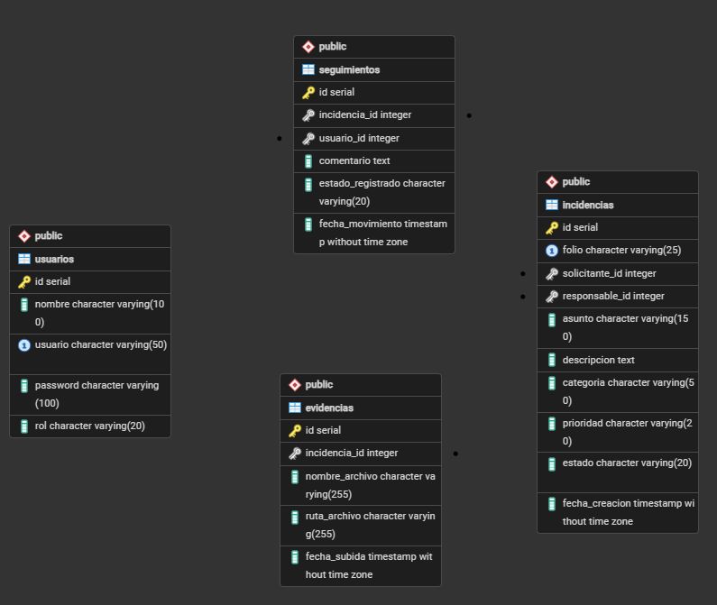

# HelpDesk

Sistema web de mesa de ayuda para registrar, consultar y dar seguimiento a incidencias técnicas o de mantenimiento.

Permite a los solicitantes crear reportes con prioridad y evidencia adjunta, mientras que el personal de soporte puede asignar responsables, cambiar el estado de las incidencias y mantener un historial de movimientos.

## Características

- Inicio de sesión según el rol del usuario.
- Roles disponibles: **Solicitante** y **Soporte**.
- Registro de incidencias con folio único.
- Clasificación por categoría y prioridad.
- Estados: **Abierto**, **En atención** y **Resuelto**.
- Adjuntar una evidencia por incidencia.
- Historial de seguimientos y responsables.
- Filtros por estado, categoría y prioridad.
- Restricción de consulta para que cada solicitante vea únicamente sus incidencias.

## Tecnologías

- Node.js
- Express
- PostgreSQL
- `pg`
- `multer`
- `dotenv`
- HTML, CSS y JavaScript

## Estructura del proyecto

```text
HelpDesk/
├── public/
│   ├── index.html          # Página principal
│   ├── login.html          # Inicio de sesión
│   ├── solicitante.html    # Panel del solicitante
│   ├── solicitante.js
│   ├── soporte.html        # Panel de soporte
│   ├── soporte.js
│   ├── auth.js
│   └── styles.css
├── server.js               # API y servidor Express
├── Tabla_Registros.sql     # Esquema y datos de ejemplo
├── Tablas.pgerd            # Modelo de la base de datos
├── Tablas.pgerd.png        # Diagrama de la base de datos
├── package.json
└── package-lock.json
```

## Modelo de datos

La base de datos contiene cuatro entidades principales:

- `usuarios`: usuarios del sistema y su rol.
- `incidencias`: reportes registrados por los solicitantes.
- `seguimientos`: historial de cambios y comentarios.
- `evidencias`: archivos asociados a una incidencia.



## Requisitos

- Node.js 18 o superior.
- PostgreSQL 13 o superior.
- npm.

## Instalación

### 1. Clonar el repositorio

```bash
git clone https://github.com/JairCadenas/HelpDesk.git
cd HelpDesk
```

### 2. Instalar dependencias

```bash
npm install
```

### 3. Crear la base de datos

Crea una base de datos PostgreSQL y ejecuta el script incluido:

```bash
psql -U postgres -d helpdesk -f Tabla_Registros.sql
```

También puedes ejecutar el contenido de `Tabla_Registros.sql` desde pgAdmin u otra herramienta compatible.

### 4. Configurar variables de entorno

Crea un archivo `.env` en la raíz del proyecto:

```env
DB_HOST=localhost
DB_PORT=5432
DB_USER=postgres
DB_PASSWORD=tu_contraseña
DB_NAME=helpdesk
PORT=3000
```

### 5. Crear el directorio de evidencias

```bash
mkdir uploads
```

### 6. Iniciar la aplicación

```bash
node server.js
```

Abre [http://localhost:3000](http://localhost:3000) en el navegador.

## Usuarios de prueba

Los usuarios incluidos en `Tabla_Registros.sql` son:

| Usuario | Contraseña | Rol |
|---|---|---|
| `solicitante1` | `1234` | Solicitante |
| `solicitante2` | `1234` | Solicitante |
| `soporte1` | `1234` | Soporte |

> Las credenciales anteriores son exclusivamente para demostración. Antes de usar el proyecto en producción, implementa contraseñas cifradas y autenticación basada en sesiones o tokens.

## Uso

### Solicitante

1. Inicia sesión con una cuenta de solicitante.
2. Registra una incidencia indicando asunto, descripción, categoría y prioridad.
3. Opcionalmente adjunta una imagen como evidencia.
4. Consulta el estado y el historial de tus reportes.

### Soporte

1. Inicia sesión con la cuenta de soporte.
2. Consulta todas las incidencias.
3. Filtra por estado, categoría o prioridad.
4. Asigna un responsable.
5. Cambia el estado y registra un comentario de seguimiento.

## Endpoints principales

| Método | Ruta | Descripción |
|---|---|---|
| `POST` | `/api/login` | Autentica al usuario |
| `GET` | `/api/incidencias` | Obtiene incidencias y permite aplicar filtros |
| `POST` | `/api/incidencias` | Crea una incidencia y una evidencia opcional |
| `POST` | `/api/incidencias/:id/seguimiento` | Actualiza el estado y agrega un seguimiento |

## Evidencias

Las evidencias se almacenan actualmente en el directorio local `uploads/` y se sirven mediante la ruta `/uploads`. Para un despliegue en varios servidores o en la nube, se puede sustituir esta implementación por almacenamiento externo como Amazon S3 o Azure Blob Storage.

## Consideraciones de seguridad

Este proyecto es una versión funcional para fines académicos o de demostración. Antes de llevarlo a producción se recomienda:

- Cifrar las contraseñas con `bcrypt` o una biblioteca equivalente.
- Implementar autenticación y autorización en el servidor.
- Validar permisos en cada endpoint.
- Validar tipos y tamaños de archivos.
- Usar variables de entorno y secretos administrados.
- Añadir protección contra ataques CSRF y otros riesgos comunes.

## Autores

- [Jair Cadenas](https://github.com/JairCadenas)
- [Laura Toledo](https://github.com/altoledo27)
- [Carlos Rafael](https://github.com/ElmarcanitoGTR)
- [Luisa Michille Ortiz Conejo](https://github.com/Mich0-14)
- [Mochi-Pichy](https://github.com/Mochi-Pichy)
